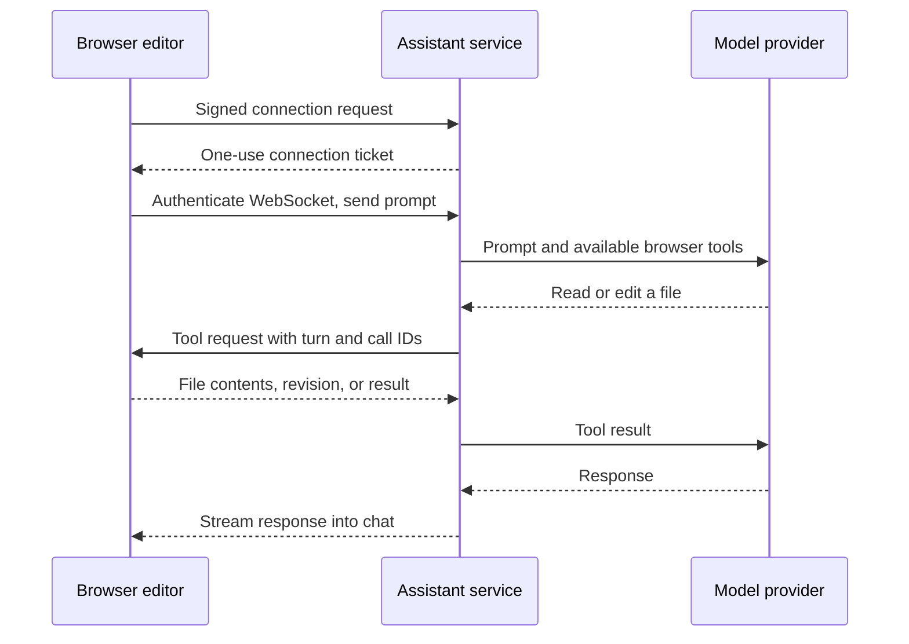

# Web assistant

The browser owns the open project. A Node service runs pi's agent loop with Claude or
Codex OAuth and asks the browser to execute tools over a WebSocket. It never creates
a server workspace. Files imported from a computer follow exactly the same path as
projects created in the browser; the original folder on the computer is unchanged.



Only requested file contents, scene context, and attached images go through the
assistant to the model. This is separate from account sync, which continues copying
project files to private storage as before. The service's OAuth session stays on the
server. All permitted wallets use that operator's subscription; this version does
not provide per-user provider login or usage accounting.

## Deploy with a Claude setup token

Run `claude setup-token` once on your computer, then save the result in your
deployment's secret manager as `ANTHROPIC_OAUTH_SETUP_TOKEN`. Claude documents this
as a one-year token for unattended model requests ([authentication docs](https://code.claude.com/docs/en/authentication#generate-a-long-lived-token)).
The variable is read only by the Node service; never add it to the web bundle.

For local development, put the token in `packages/service/.env` as
`ANTHROPIC_OAUTH_SETUP_TOKEN=…`. The service loads that file automatically through
its config component. Injected environment variables override the file.
The [container deployment guide](../packages/service/README.md#container-deployment)
covers the Dockerfile, Compose, persistent storage, and production ingress.

```bash
# ANTHROPIC_OAUTH_SETUP_TOKEN is injected by the deployment platform.
node packages/service/dev-server.ts --host 0.0.0.0 --port 8787 \
  --data /data/projects --origin https://your-editor.example
```

At startup, the service saves that token as an OAuth access credential in
`<data>/../.assistant/.auth.json` (mode 0600), or the path supplied with `--ai-auth`.
It preserves other providers' sessions. Changing the secret and restarting rotates
Claude's credential; restarting with the same token preserves its recorded expiry.
A setup token has no refresh token: replace it when it expires or is revoked.
The provider controls actual expiry; redeploying does not renew the token.

Keep that file out of the project data: pass `--ai-auth` (or `AI_AUTH_PATH`) pointing at a
secret mount, or the service warns at startup. In production (`NODE_ENV=production`) the service
refuses to start the assistant without `ASSISTANT_WALLETS` (a wallet list, or `*`), and caps turns
with `ASSISTANT_TURNS_PER_MINUTE` (all wallets) and `ASSISTANT_TURNS_PER_DAY` (per wallet).

## Run locally with browser sign-in

From the repository root, with Node 24 and dependencies installed:

```bash
node packages/service/scripts/assistant-login.ts --provider claude --auth /absolute/path/.auth.json
# Or --provider codex. Complete the OAuth flow in your browser.

node packages/service/dev-server.ts --port 8787 --data /tmp/dcl-projects \
  --origin http://localhost:5230 --ai-auth /absolute/path/.auth.json
# Optional: --ai-model <model-id> replaces claude-opus-5-5, the only model the assistant uses.

npm run build -w @dcl-editor/web
```

The sign-in command stores an OAuth session using pi's credential format. An existing
compatible session file can be passed directly to `--ai-auth`; token refresh is
handled by pi. API-key authentication is disabled for both providers in the service.

Serve the web editor from the bevy-web host with its v1 `services.projects` URL
pointing at this service and sign in to Decentraland. The assistant shares the
host's signed-fetch identity and the existing chat/Script Studio UI. Select an
entity and ask for a behavior, or explicitly ask to edit `src/index.ts` for a
scene-wide change. **Recheck** refreshes the available providers after sign-in.

Without `--ai-auth` or the setup-token secret, the service answers assistant routes with 503 and the chat
shows that the service is unavailable. A v0 host or a host without a project-service
URL keeps its previous code-only UI. Cloudflare's project-storage Worker does not
host the assistant; it currently requires the Node entry point and WebSocket upgrades.

If a local scene builds but stays at **Connecting to scene…**, check the Explorer
bridge server as well as the editor bundle. The bridge must come from the host
checkout that implements `editorScene` messages. A different worktree already
serving port 8100 can be silently reused. Start the matching bridge on an unused
port and select it with `?systemScene=http://localhost:<port>` on the editor URL.

## Decentraland SDK skills

The service ships 22 SDK skills and 72 guidance/reference documents from a pinned
snapshot of `decentraland/sdk-skills`. The model sees the topic catalog and uses
`read_skill` to load relevant guidance before writing SDK code. Large documents
are paginated; asset catalogs support literal text search. No runtime download or
new secret is needed, and the Docker image includes the same snapshot.

The skill reader is a Well-Known Component injected into the agent factory. It
reads only the packaged document map, never arbitrary paths on the server. These
skills add SDK knowledge; they do not add shell, network, MCP, image download,
file-storage or publishing tools. Assets must already be imported into the browser
project. Desktop-only workflows are omitted, and the web prompt adapts script paths
and entity edits to the editor's own tools.

Source pin, license and update instructions: [service skills](../packages/service/skills/README.md).

## Tools and lifecycle

The Node entry point uses Decentraland Well-Known Components, following
`world-storage-service`: typed dependencies in `src/types.ts`, construction in
`src/components.ts`, routing in `src/controllers/routes.ts`, and startup in
`src/service.ts`. The shared HTTP server handles WebSocket upgrades. Its lifecycle
closes sessions and cancels pending browser calls before stopping HTTP and draining
the purge job. Configuration, logging, health probes and metrics use the shared
components; see the [service README](../packages/service/README.md).

- `list_files`, `read_file`: readable project text, excluding hidden paths,
  credentials, dependencies and build output. Reads are limited to 256 KiB each.
- `write_file`: source code under `src/`, excluding generated runtime directories.
  An edit must supply the revision returned by a read; creating a file requires
  `revision: null` and an absent path. A concurrent change rejects the write.
  File checks and writes share the editor's write queue. A new `src/scripts/` file
  is attached right away to the entity selected when the turn began,
  and the result names it as `attached`; later writes in the turn refresh its
  parameters. The desktop CLI attaches new scripts when its turn ends instead.
- `scene_request`: inspect, create an entity, set an authorable component, attach
  a script, set script parameters, or place an existing prefab. These use the same
  editor actions as the UI, with undo and autosave. Component replacement requires
  the previously inspected value. Mutations require edit mode.
- `build`: compile the current browser project and return diagnostics. The creator
  presses Play to run it. There is no shell, package installation, deletion or
  publishing tool.
- `read_skill`: server-side, read-only SDK guidance from the bundled library, with
  at most 16,000 characters per page or 20 search matches. This never requests a
  browser file and cannot read credentials or private project storage.

A conversation lives in memory on one connection and stays with that browser's
project, provider and model. Stop, New chat, project changes, account changes and
disconnects cancel outstanding requests. Project transitions drain any in-flight
browser action before opening another scene. Completed edits remain saved; an
interrupted request is never replayed automatically. When a turn reaches its time or
tool-result limit, the service keeps the conversation and the chat shows it as paused;
Continue sends a short continue prompt to that same conversation. If the connection
closed meanwhile, Continue starts the original request over and says so.

The chat itself is kept in the browser per wallet and project (OPFS
`dcl-editor/assistant/<project>@<wallet>.json`, the last 100 messages up to 256 KB,
without images) and comes back on reload under "Earlier conversation". It is only
shown: the assistant starts each session without it, and nothing in it is re-sent.
Another wallet on the same browser never sees it; purging the project deletes it.
New chat (the assistant or Studio header) stops any turn and empties it.

The signed HTTP endpoints are `GET /assistant/providers` and
`POST /assistant/connect`. They use the same editor-only ADR-44 validation as project
storage and reject scene-signed requests. A connection ticket lasts 30 seconds, is
bound to the wallet and origin, and is presented as `dcl-ticket.<token>` alongside
`dcl-assistant-v1` in the `Sec-WebSocket-Protocol` upgrade header, never in a URL.
Only `dcl-assistant-v1` is echoed in the response. Authentication and connection
capacity are checked before the upgrade; there is no unauthenticated socket phase.
The endpoint is `/assistant/socket` under the configured base path. A reverse proxy
must preserve paths, origins, protocol headers and WebSocket upgrades, and must not
log credential headers. Deploy the updated browser client and service together.

Fixed limits: 32 connections per service, 3 per wallet, 10 turns and 10 connection
tickets per minute per wallet; 10 minutes per turn; 60 seconds per browser call.
Idle connections expire after 15 minutes. These limits live in one process. Prompts allow four images of at most 2 MiB each.

## Validation

```bash
npm run validate
npm run validate -w @dcl-editor/web

# Optional real model test: uses a synthetic project and the supplied OAuth session.
ASSISTANT_LIVE_AUTH=/absolute/path/.auth.json node packages/web/validate/smoke.mjs
# Optional ASSISTANT_LIVE_MODEL=<model-id>, SMOKE_SCREENSHOTS=/tmp/editor-shots
```

Unit tests cover stale writes, path restrictions, cancellation, request correlation,
timeouts, editor-only authentication and single-use tickets. Component integration
tests also cover storage responses, CORS, metrics and shutdown during a tool call.
The browser smoke test uses a deterministic agent behind the real component
lifecycle and signed HTTP/WebSocket transport, with a separate browser origin. It
reads and edits `src/index.ts`, builds in the browser, verifies the saved OPFS file
and chat response, then verifies account sync and publishing still work. It uses a
fake engine host; real-engine gates remain in bevy-web's `react-web/e2e/`.

Implementation: `packages/service/src/ai/` runs the agent and transport;
`packages/web/src/ai/` handles tools and scene actions;
`packages/contract/src/assistant.ts` defines their messages.
